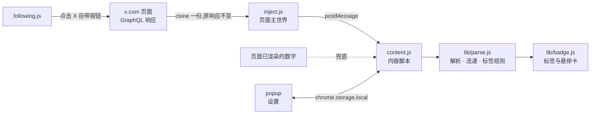

<div align="center">


# Snow X Assistant

**一眼看出哪条推文正在起飞,哪个账号值得关注。**

在 X(Twitter)的信息流里,为每条推文标出实时流速,为每个账号标出粉丝量级与质量。<br>
另附一套克制、可控的互关清理工具。全程只读页面已有数据,不额外请求任何接口。

<p>
  
  
  
  
  
  
</p>

<p>
  <a href="#特性">特性</a> ·
  <a href="#主题">主题</a> ·
  <a href="#安装">安装</a> ·
  <a href="#隐私">隐私</a> ·
  <a href="#工作原理">工作原理</a> ·
  <a href="#常见问题">常见问题</a>
</p>

<picture>
  <source media="(prefers-color-scheme: dark)" srcset="docs/images/hero-dark.png">
  <source media="(prefers-color-scheme: light)" srcset="docs/images/hero-light.png">
  
</picture>

</div>

<br>

## 特性

<table>
<tr>
<td width="33%" valign="top">

### 推文流速

`浏览量 ÷ 发布至今小时数`。低于 1k/h 只显示灰色数字,1k、5k、1w 起依次进入三档 🚀,档位越高越亮,爆款带光晕,滑动信息流时一眼就能抓住。

</td>
<td width="33%" valign="top">

### 账号标签

粉丝量级、粉丝/关注比,以及互关、大V、新号、老号、高互动、低活跃、疑似互粉号七种质量标签,每一项都能单独开关。

</td>
<td width="33%" valign="top">

### 互关清理

在自己的「正在关注」页筛出未回关账号,勾选后批量取关。带间隔、抖动、单次上限与随时停止,节奏由你掌控。

</td>
</tr>
</table>

- 三个功能各有独立开关,互不影响。只想看流速,就只开流速。
- 悬停任意标签,弹出账号与推文的详细数据卡:粉丝、关注、比值、注册时间,以及浏览、赞、转、评、藏和爆款分。
- 自动适配 X 的浅色、暗蓝、纯黑三种背景。
- 标题行太挤时,标签自动换到下一行,不遮挡用户名。

## 主题

八套主题,形状、字体与排版各不相同,不只是换个颜色。流速、账号标签和悬停卡共用同一套主题。

<p align="center">
  
</p>

| 主题 | 风格 | 流速的表达方式 |
|---|---|---|
| 信号灯 | 实心圆角胶囊(默认) | 灰 / 绿 / 橙 / 红色块,光晕逐级增强 |
| 徽章 | shields.io 两段式,方角 | 左侧写「流速」,右侧数值按档位上色 |
| 贴纸 | 粗黑描边、硬投影、交替微倾 | 普通档虚线描边,爆款更歪更大 |
| 终端 | 一整条命令行,等宽字体 | 普通档 `~` 前缀,其余为 🚀 加文字发光 |
| 热度条 | 无框文字,质量标签带下划线 | 五格进度条,绿到红渐变 |
| 霓虹 | 透明底、发光描边 | 青 / 黄 / 洋红霓虹框 |
| 原生文字 | 无框,`·` 分隔,最接近 X 原生 | 仅以亮色文字区分 |
| 极光 | 渐变描边胶囊 | 渐变填充,爆款呼吸光晕 |

## 设置

<table>
<tr>
<td align="center" width="50%"><br><sub>标签:开关、显示项与流速阈值,顶部实时预览</sub></td>
<td align="center" width="50%"><br><sub>主题:大卡片预览,可切换浅色 / 深色背景对比</sub></td>
</tr>
</table>

弹窗分为「标签」「主题」「互关清理」三个页签,所有改动即时生效,无需刷新页面。

## 安装

> [!NOTE]
> 目前尚未上架 Chrome 网上应用店,请以「开发者模式」加载。Edge、Brave、Arc 等 Chromium 内核浏览器通常也可按相同方式加载,但尚未逐一验证。

1. 下载本仓库(`Code → Download ZIP` 后解压,或 `git clone`)。
2. 打开 `chrome://extensions`,开启右上角的 **开发者模式**。
3. 点击 **加载已解压的扩展程序**,选择仓库根目录(包含 `manifest.json` 的那一层)。
4. 打开或刷新 [x.com](https://x.com)。互关清理需进入 `x.com/<你的用户名>/following`。

> [!IMPORTANT]
> 加载后请勿删除或移动该目录,否则扩展会失效。更新版本时,替换目录内容后在扩展页点击刷新即可。

## 使用说明

### 流速

| 档位 | 默认阈值 | 显示 |
|---|---|---|
| 普通 | 低于 1,000 浏览/小时 | 灰色数字,无图标 |
| 升温 | 1,000 浏览/小时起 | 🚀 第一档 |
| 热门 | 5,000 浏览/小时起 | 🚀 第二档,更亮并带光晕 |
| 爆款 | 10,000 浏览/小时起 | 🚀 第三档,最亮,光晕最强 |

三个阈值都可以在弹窗中自定义,必须从小到大递增。新号和大号的基准差别很大,建议按你常看的圈子调整。

### 账号标签

粉丝数前的圆点表示量级:蓝色千级、紫色万级、粉色十万级、橙色百万级。质量标签基于经验阈值,只作参考:

| 标签 | 判定规则 |
|---|---|
| 互关 / 关注了你 | 来自 X 返回的关系字段 |
| 大V | 粉丝 ≥ 1 万,且粉丝/关注 ≥ 10 |
| 疑似互粉号 | 关注 ≥ 1,000,粉丝 < 5,000,粉丝/关注在 0.8 到 1.25 之间 |
| 新号 | 注册不足 90 天 |
| 老号 | 注册超过 8 年 |
| 高互动 | 近期推文互动/浏览 ≥ 3% |
| 低活跃 | 粉丝 ≥ 5,000,但互动/浏览 < 0.1% |

### 互关清理

<p align="center">
  
</p>

- **只在自己的关注页出现**,其他页面不加载任何清理逻辑。
- **宁漏勿误**:同时参考页面上的「关注了你」标记和 X 返回的关系数据,无法确认时不会被选为未回关。
- **模拟真人节奏**:点击 X 自带的「正在关注 → 取消关注」按钮完成,默认间隔 1.5 秒并加随机抖动,可在 1 到 5 秒之间调整。
- **有上限,可中止**:单次最多 100 个,执行前二次确认,过程中随时可停;只有按钮真正变回「关注」才计为成功。

> [!WARNING]
> 短时间内大量取关可能触发 X 的风控。建议分批进行,每小时不超过 50 人。

## 隐私

Snow X Assistant 的设计前提是:**不让你的数据离开浏览器**。

| | |
|---|---|
| 网络请求 | 不发起任何请求。数据来自 X 页面本身已经加载的 GraphQL 响应,以及页面上已渲染的数字 |
| 权限 | 只申请 `storage`。没有 `host_permissions`,没有后台脚本,无法访问其他网站 |
| 存储 | 仅在 `chrome.storage.local` 保存你的设置,不记录浏览历史、不保存账号数据 |
| 第三方 | 无统计、无遥测、无远程配置、无 CDN 依赖 |
| 代码 | 无构建、无压缩,你加载的就是仓库里的源码,可逐行审阅 |

## 工作原理



```
snow-x-assistant
├── manifest.json     # MV3 清单,仅 storage 权限
├── inject.js         # 页面主世界:复制 X 自身的 GraphQL 响应
├── content.js        # 内容脚本:缓存数据、定位推文、挂载标签与悬停卡
├── content.css       # 八套主题与悬停卡样式
├── following.js      # 互关清理工具栏与取关队列
├── lib/
│   ├── parse.js      # 纯函数:解析、流速、质量标签、设置校验
│   └── badge.js      # 标签 DOM 构建,弹窗与页面共用
├── popup.html/js/css # 设置弹窗
└── tests/            # node:test 单元测试
```

## 常见问题

<details>
<summary><b>为什么有些推文没有标签?</b></summary>
<br>
插件只使用 X 已经返回给页面的数据。某些位置(例如部分广告、未加载完的卡片)没有对应数据时,标签就不会出现。滚动或刷新后通常会补上。
</details>

<details>
<summary><b>流速和 X 后台的数据为什么不完全一致?</b></summary>
<br>
流速是「当前浏览量 ÷ 发布至今的小时数」得出的平均值,反映整体热度,而不是此刻的瞬时速度。刚发布几分钟的推文波动会比较大。
</details>

<details>
<summary><b>会不会导致账号被限制?</b></summary>
<br>
标签功能完全只读,不产生任何请求,不会对账号造成影响。互关清理会执行真实的取关操作,请保持默认节奏并分批进行。
</details>

<details>
<summary><b>X 改版后失效了怎么办?</b></summary>
<br>
解析逻辑集中在 <code>lib/parse.js</code>,页面定位在 <code>content.js</code> 与 <code>following.js</code>。欢迎提交 Issue,附上出问题的页面截图会很有帮助。
</details>

## 开发

无构建步骤,修改源码后在 `chrome://extensions` 点击刷新即可生效。

```bash
node --test tests/
```

提交改动前请确保:

- 不引入新的网络请求或权限;
- 新的解析逻辑以纯函数形式放进 `lib/parse.js`,并补充对应测试;
- 不修改 X 的原始请求与响应。

## 免责声明

本项目为个人开源作品,与 X Corp. 无任何关联。质量标签基于公开数据与经验阈值,不代表对任何账号的评价。使用互关清理功能产生的后果由使用者自行承担。

## 许可

[MIT](LICENSE)

<div align="center">
<br>
<sub>为在 X 上认真阅读的人而做。</sub>
</div>
